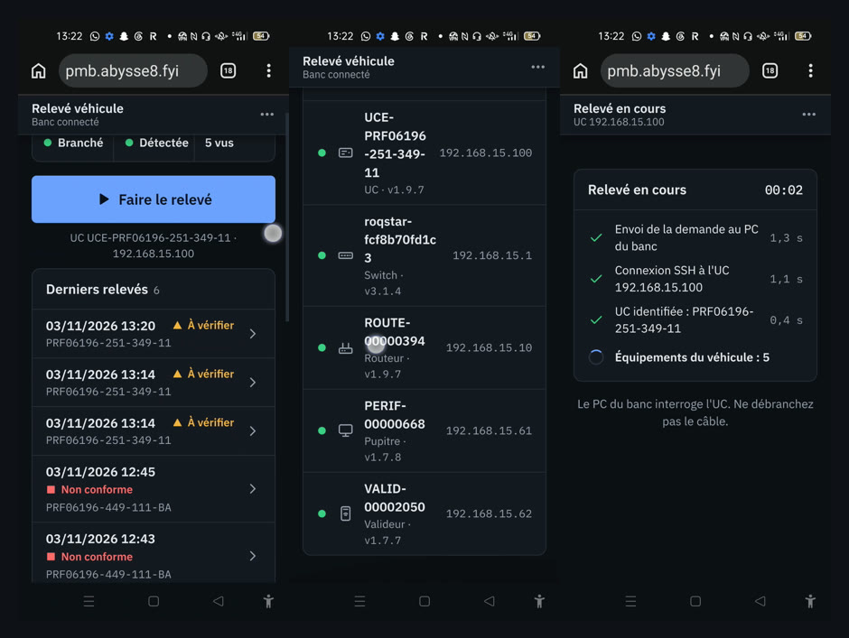

# Relevé véhicule — démo (prototype SVT)

Démonstration du prototype de **relevé véhicule depuis un téléphone** : le PC du banc,
branché au véhicule, interroge l'UC et tous ses équipements ; le téléphone affiche le
résultat (verdict, équipements dépliables avec versions et identité, journal d'événements).

▶ **[Voir la vidéo (56 s, 3,4 Mo)](https://github.com/abysse8/pmb-releve-demo/raw/main/releve-pmb-demo.mp4)** — sur téléphone, elle peut se télécharger avant de se lire.

Enregistrée le 3 novembre 2026 sur le banc billettique. Prototype, retours bienvenus.
